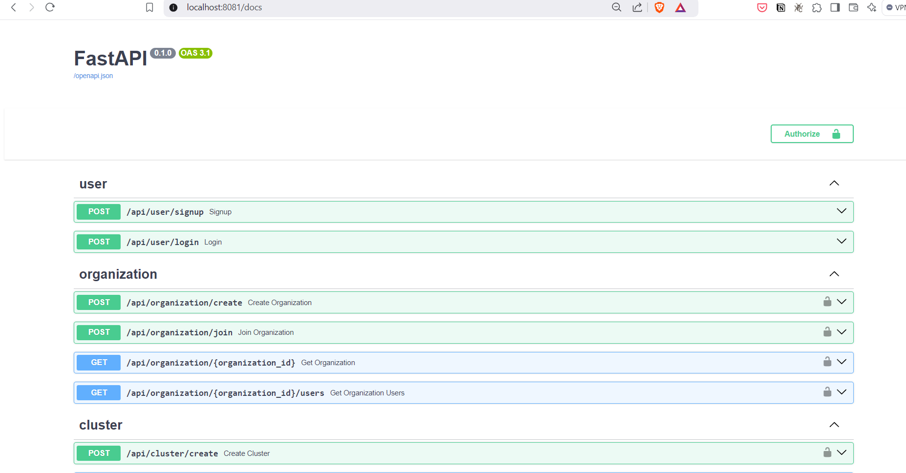
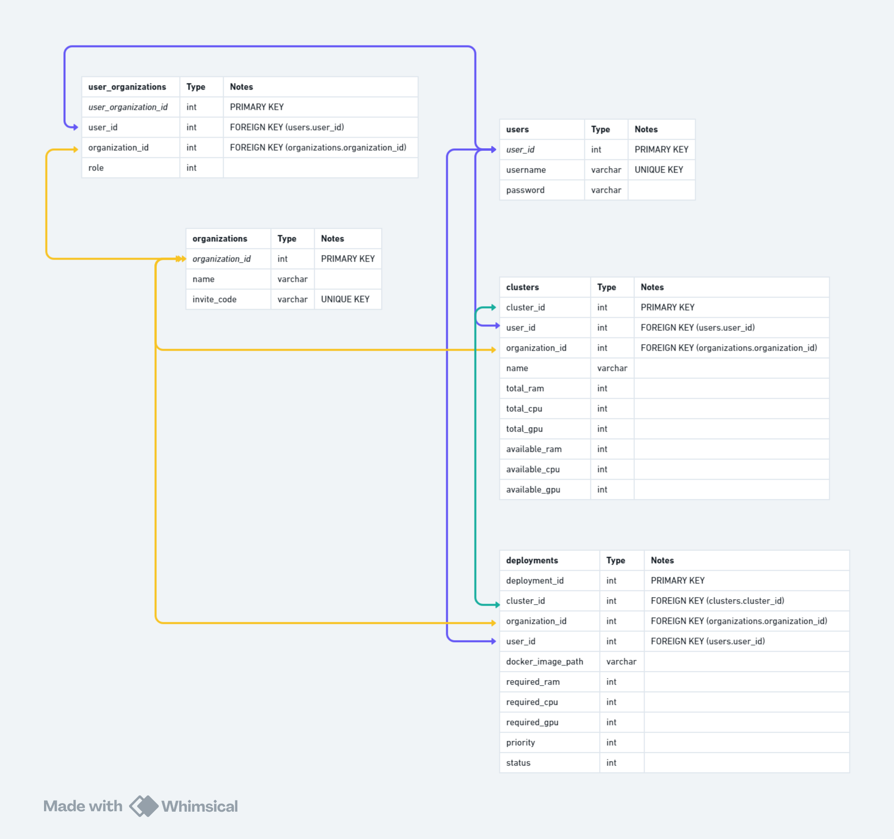

# Clusterflow

[](https://github.com/ysskrishna/clusterflow/blob/main/LICENSE) [](https://ysskrishna.space)

## Hypervisor-like Service for MLOps Platform

## Techstack used
- FastAPI
- SQLite
- Redis
- SQLAlchemy
- Docker


## Prerequisites

- Python 3.10+
- pip
- virtualenv
- docker


## Running the backend service
```
docker compose  -f docker-compose.yml up --build
```


The server will be available at `http://localhost:8081/`

### API Documentation

Access the Swagger UI documentation at `http://localhost:8081/docs`


## Postman v2.1 collection file
`ClusterFlow_postman_2_1.postman_collection.json`


## Database Diagram



## Built and maintained by

Clusterflow is built and maintained by:

| | Name | GitHub | Role |
|---|------|--------|------|
|  | **Y. Siva Sai Krishna** | [@ysskrishna](https://github.com/ysskrishna) | Creator |

## Support

If you find this project helpful:

- ⭐ Star the repository
- 🐛 [Report issues](https://github.com/ysskrishna/clusterflow/issues)
- 🔀 Submit pull requests
- 💝 [Sponsor on GitHub](https://github.com/sponsors/ysskrishna)

## License

MIT © [Y. Siva Sai Krishna](https://github.com/ysskrishna) — see [LICENSE](LICENSE) for details.

---

<p align="left">
  <a href="https://github.com/ysskrishna">Author's GitHub</a> •
  <a href="https://linkedin.com/in/ysskrishna">Author's LinkedIn</a> •
  <a href="https://ysskrishna.space">Author's site</a> •
  <a href="https://github.com/ysskrishna/clusterflow/issues">Report Issues</a>
</p>
